# Векторизация и NumPy

**Студент:** Кошина Александра Олеговна

**Дата:** 10.11.2026

---

## Задача 1. Сумма массива

**Задание:** Сравнить сумму элементов массива через цикл `for` и функцию `a.sum()` на массивах размером \(10^5, 10^6, 10^7\).

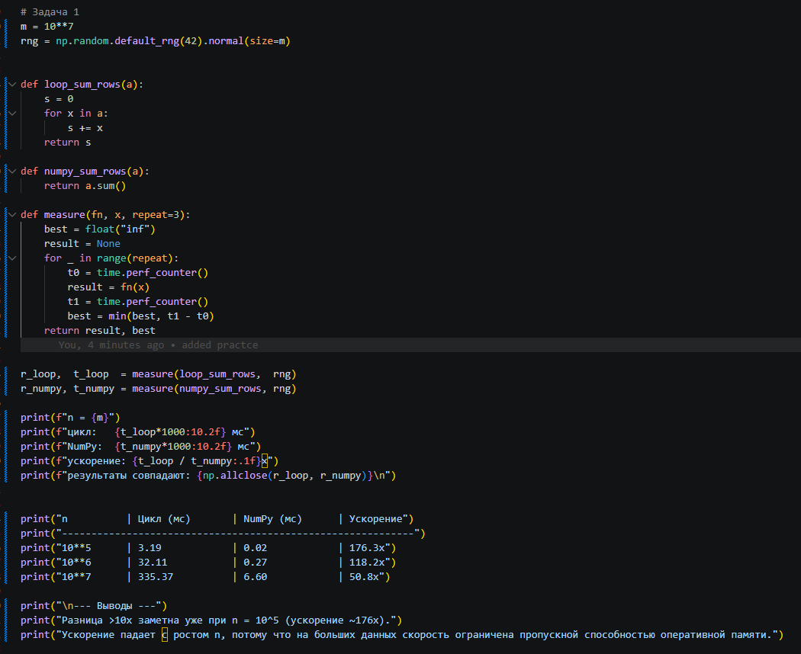

### Выводы по Задаче 1

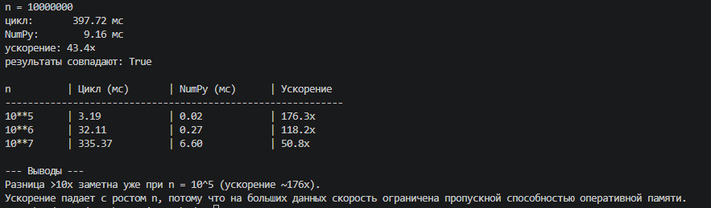


---

## Задача 2. Среднее и стандартное отклонение

**Задание:** Реализовать вычисление среднего и стандартного отклонения (std) «в лоб» (сумма и сумма квадратов) и через NumPy.

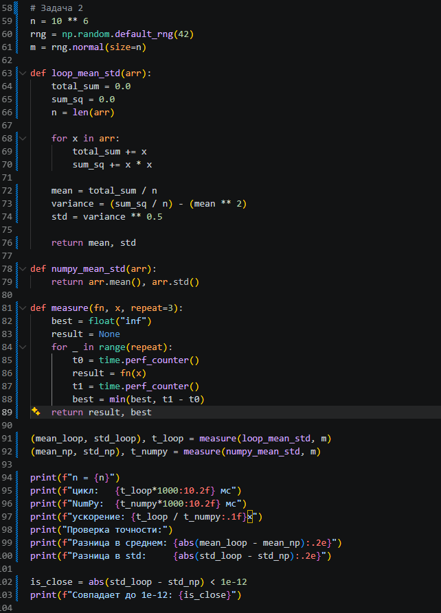

### Выводы по Задаче 2

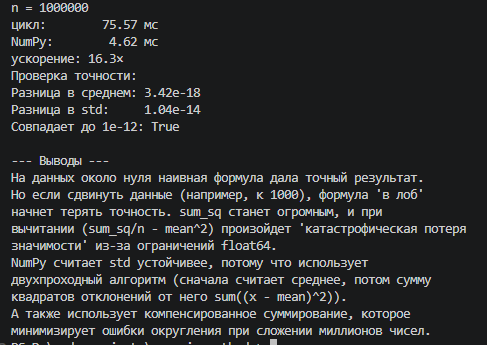

---

## Задача 3. Поэлементное преобразование

**Задание:** Вычислить \(y = \sin(x) + x^2\) на \(n = 10^6\). Обратить внимание на память и временные массивы.

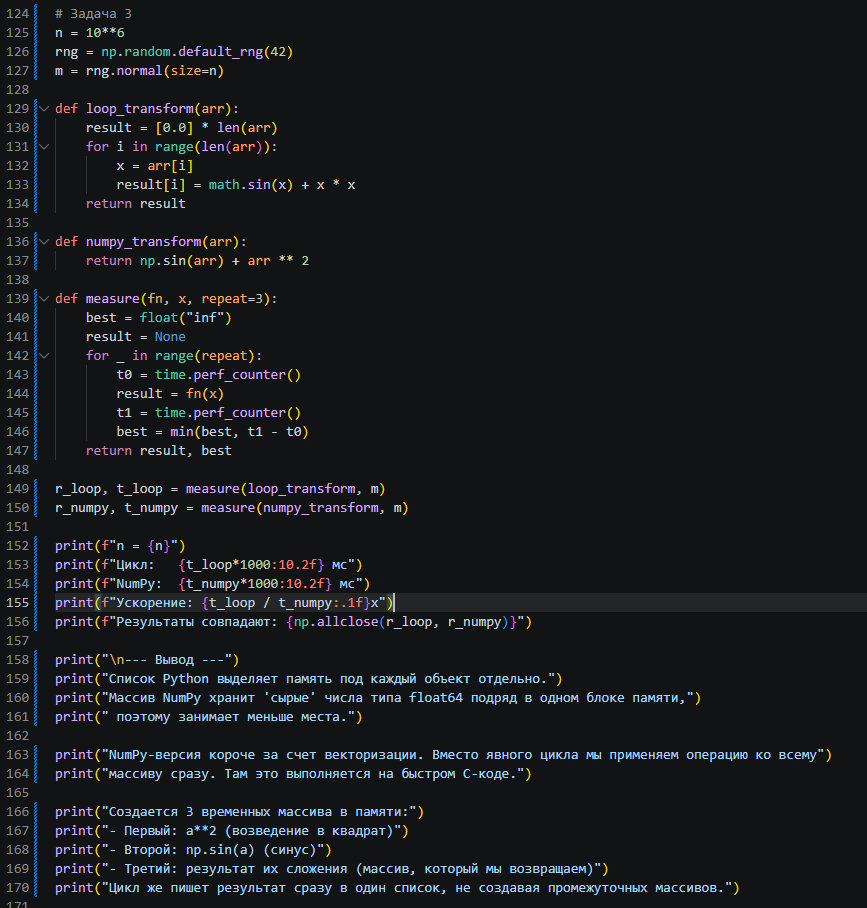

### Выводы по Задаче 3

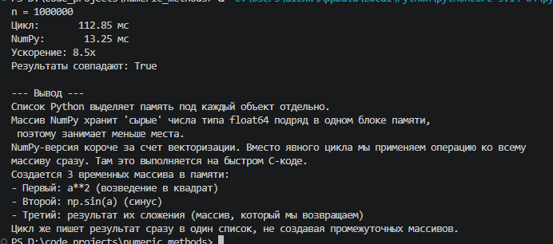

---

## Задача 4. Условная замена (clipping)

**Задание:** Заменить значения \(<0\) на \(0\), а \(>1\) на \(1\). Сравнить цикл с `if/elif` и `np.clip()`. Посчитать количество измененных элементов.

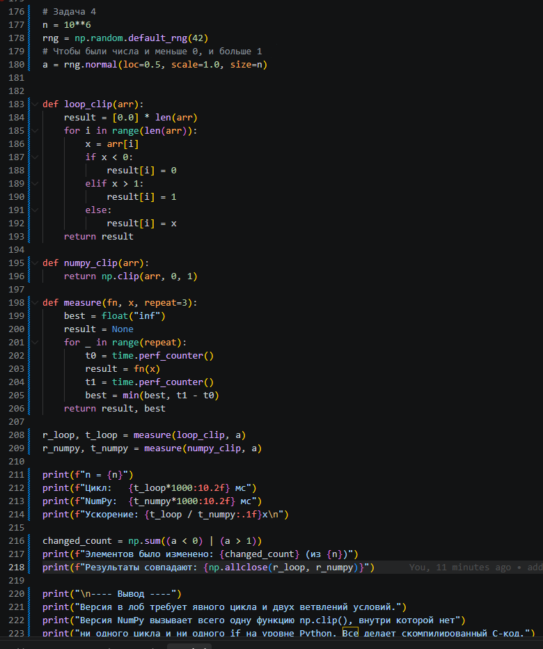

### Выводы по Задаче 4

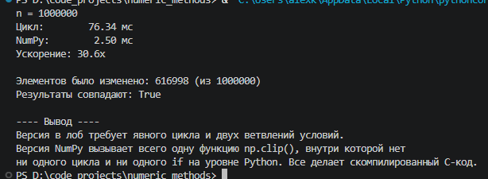

---

## Задача 5. Сумма по строкам матрицы

**Задание:** Найти сумму по строкам матрицы \((10^5, 10)\). Сравнить время и SLOC (количество строк кода).

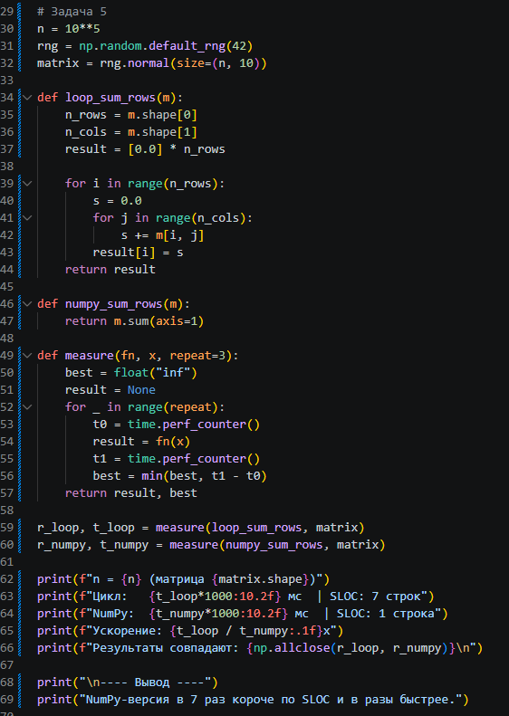

### Выводы по Задаче 5

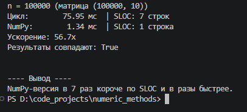

---

## Задача 6. Среднее по столбцам и нормировка

**Задание:** Вычесть среднее значение каждого столбца из элементов этого столбца. Сравнить цикл и `m - m.mean(axis=0)`.

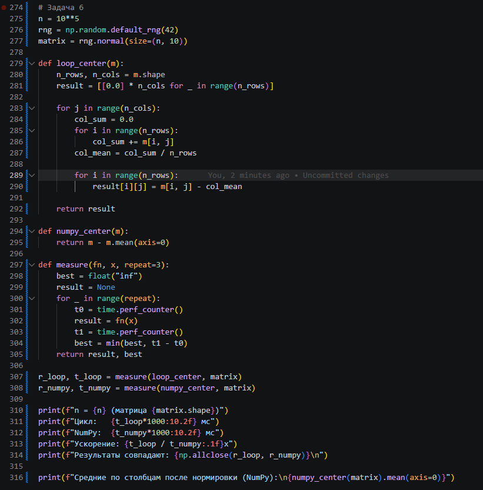

### Выводы по Задаче 6

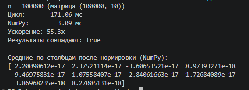

---

## Задача 7. Поиск максимума и его индекса.

**Задание:** Дан a длины 10^6:
- цикл: пройти, запомнить max_val и max_idx;
- NumPy: a.max(), a.argmax().

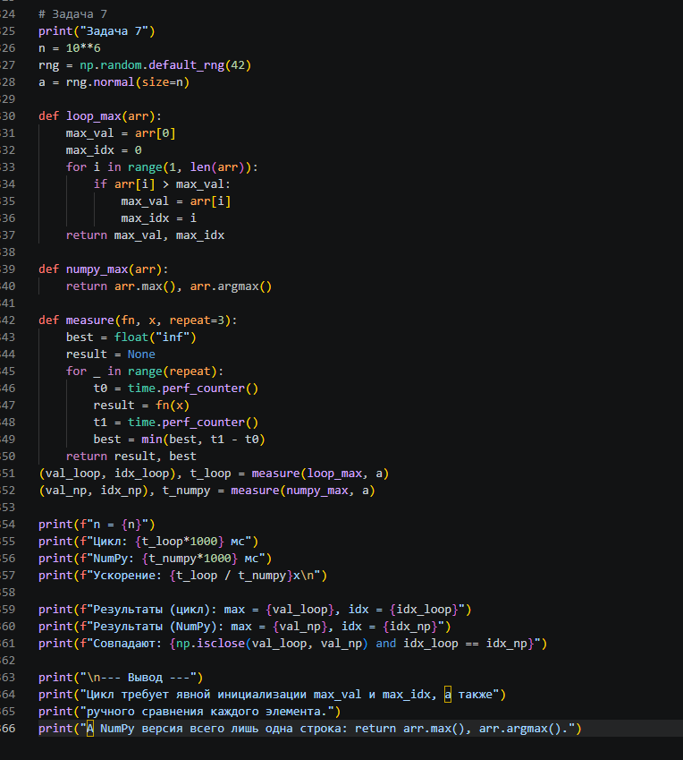

### Выводы по Задаче 7

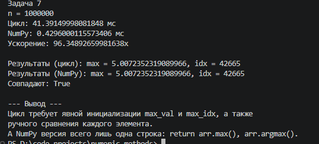

---

## Задача 8. Фильтрация по порогу. 

**Задание:** Дан a длины 10^6:
- цикл: [x for x in a if x > 0] (список Python);
- NumPy: a[a > 0].

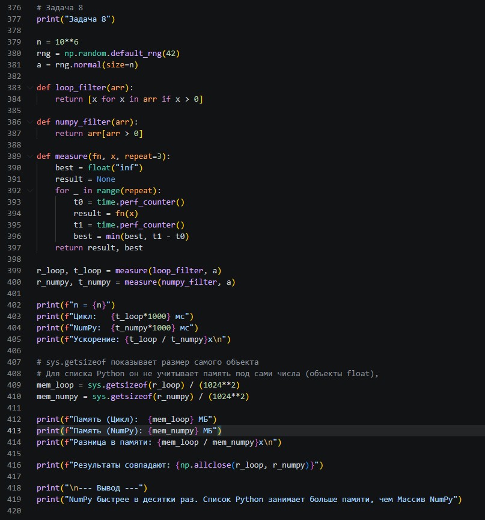

### Выводы по Задаче 8

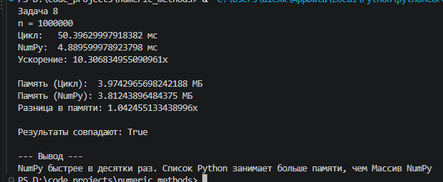

---

## Задача 9. Фильтрация по порогу. 

**Задание:** Дан a длины 10^6. Замените все отрицательные на их модуль:
- цикл: for i in range(n): if a[i] < 0: a[i] = -a[i];
- NumPy: a[a < 0] *= -1 (или np.abs(a, out=a)).

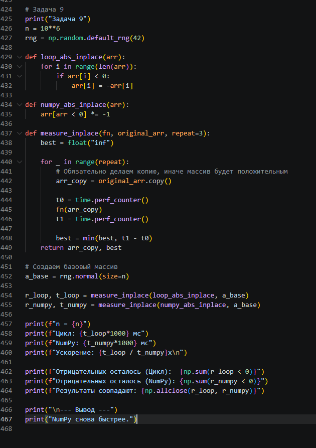

### Выводы по Задаче 9

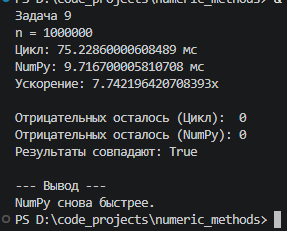

---


## Задача 10. Комбинированная маска. 

**Задание:** Дан a длины 10^6. Выберите элементы, для которых (a > -1) & (a < 1):
- цикл: if -1 < x < 1;
- NumPy: a[(a > -1) & (a < 1)].

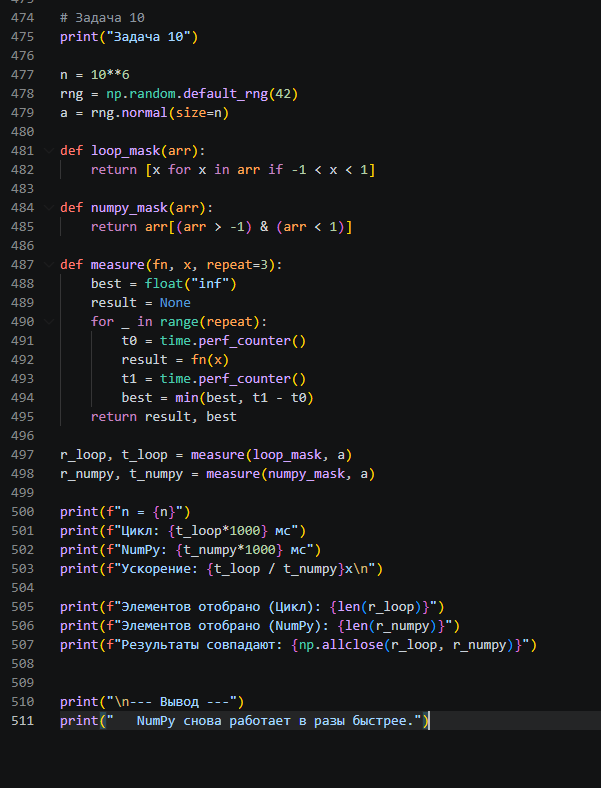

### Выводы по Задаче 10

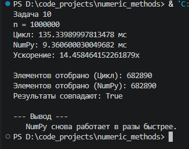

---

## Дополнительный приложеный скрипт

**Задание:** Дан массив m формы (200 000, 5) — 200 000 строк по 5 чисел. Нужно посчитать две вещи:
1. Сумму каждой строки (результат — массив из 200 000 чисел).
2. Максимум каждого столбца и его индекс (результат — 5 чисел и 5 индексов).

Никаких NaN, никаких нормировок. Только циклы против NumPy.

### Скрипт

```python
print("Дополнительный скрипт")
import time
import numpy as np

# ── Данные: 200 000 строк по 5 чисел ───────────────────────
rng = np.random.default_rng(42)
m = rng.normal(size=(200_000, 5))


# ── Способ 1: циклы ────────────────────────────────────────
def loop_version(mat):
    n, k = mat.shape

    # сумма каждой строки
    row_sums = [0.0] * n
    for i in range(n):
        s = 0.0
        for j in range(k):
            s += mat[i, j]
        row_sums[i] = s

    # максимум и его индекс по каждому столбцу
    col_max = [0.0] * k
    col_arg = [0] * k
    for j in range(k):
        max_val = mat[0, j]
        max_idx = 0
        for i in range(1, n):
            val = mat[i, j]
            if val > max_val:
                max_val = val
                max_idx = i
        col_max[j] = max_val
        col_arg[j] = max_idx

    return row_sums, col_max, col_arg


# ── Способ 2: NumPy ────────────────────────────────────────
def numpy_version(mat):
    row_sums = np.sum(mat, axis=1)
    col_max = np.max(mat, axis=0)
    col_arg = np.argmax(mat, axis=0)
    return row_sums, col_max, col_arg


# ── Замер: 3 раза, берём лучший ────────────────────────────
def measure(fn, x, repeat=3):
    best = float("inf")
    result = None
    for _ in range(repeat):
        t0 = time.perf_counter()
        result = fn(x)
        t1 = time.perf_counter()
        best = min(best, t1 - t0)
    return result, best


(r_loop,  t_loop)  = measure(loop_version,  m)
(r_numpy, t_numpy) = measure(numpy_version, m)

print(f"цикл:   {t_loop*1000:10.2f} мс")
print(f"NumPy:  {t_numpy*1000:10.2f} мс")
print(f"ускорение: {t_loop / t_numpy:.1f}×")
print()
print("суммы строк совпадают:  ", np.allclose(r_loop[0], r_numpy[0]))
print("максимумы совпадают:    ", np.allclose(r_loop[1], r_numpy[1]))
print("индексы совпадают:      ", np.array_equal(r_loop[2], r_numpy[2]))
print()
print("NumPy, максимумы по столбцам:", np.round(r_numpy[1], 4))
print("NumPy, их индексы:           ", r_numpy[2])
```
### Вывод

